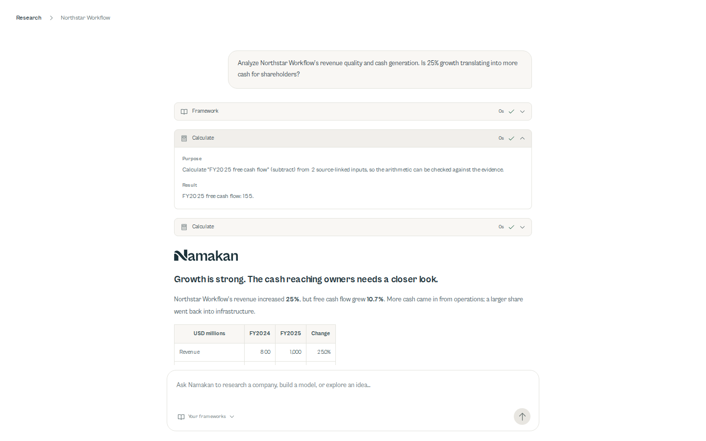
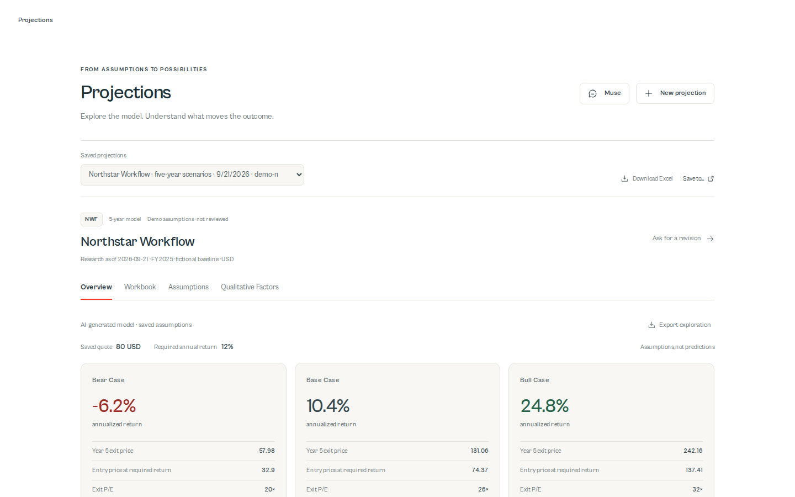
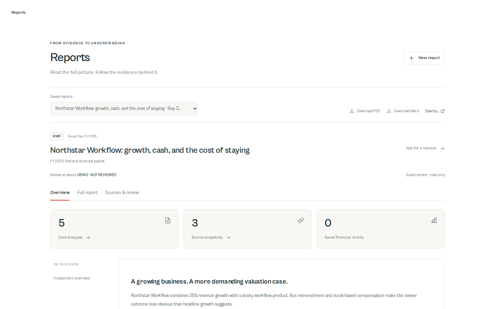
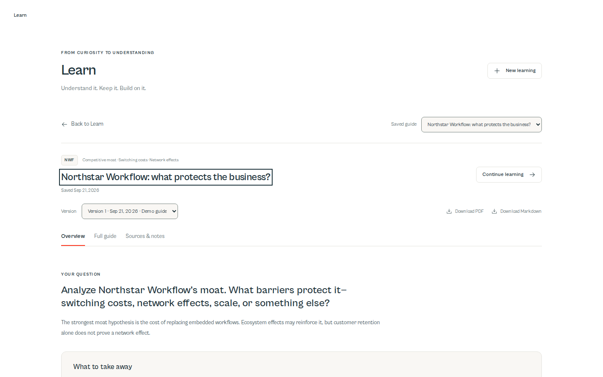

  

# Research the business. Build your conviction.

**An AI investing research workspace that brings company analysis, financial projections, reports, and learning into one place.**

Built by [Clinton Follette](https://github.com/cfollette18). Explore the product, watch the workflows, and see the engineering behind the experience.

**[Visit Namakan ↗](https://namakanai.com)** · **[Watch the demos ↗](https://cfollette18.github.io/namakan-showcase/)** · [Engineering overview](docs/ENGINEERING.md) · [Technology stack](docs/STACK.md)

> This is a public product showcase. Application source, proprietary research methods, prompts, evaluation rubrics, datasets, and private configuration are maintained separately.

## The product

Investment research often lives across filings, chat threads, spreadsheets, and downloaded reports. Namakan connects those steps in a single workspace: ask a question, inspect the evidence, examine the assumptions, and keep the resulting work.

| Workspace | What it enables |
|---|---|
| **Research** | Conversational company analysis across income statements, balance sheets, cash flow, competitive advantages, and valuation; visible tool activity and evidence-linked findings. |
| **Projections** | Bear/base/bull scenarios, five- to ten-year horizons, annual outputs, explicit assumptions, and an in-app workbook viewer with inspectable formulas. |
| **Reports** | Executive synthesis, financial charts, five connected analyses, source references, version history, and optional PDF, Word, and Markdown exports. |
| **Learn** | Company-specific explanations, expandable evidence, personal notes, saved guide versions, and follow-up questions. |
| **Connections** | Google Sheets/Drive and Microsoft Excel/OneDrive integration workflows for configured local accounts; hosted customer connections remain a separate rollout. |

[Explore the complete capability and availability guide →](docs/CAPABILITIES.md)

## Watch Namakan in action

Four short recordings of the **actual public interactive demos** at [namakanai.com](https://namakanai.com). Northstar Workflow is fictional; the examples are scripted sample research. These recordings demonstrate the interface and interactions, not live model performance or real investment results. Each video includes a text walkthrough in the gallery.

<table>
  <tr>
    <td width="50%"> <strong>01 / Research</strong> Trace the analysis, expand tool results, and follow up. <a href="https://cfollette18.github.io/namakan-showcase/#research">Watch the research demo →</a></td>
    <td width="50%"> <strong>02 / Projections</strong> Compare scenarios, inspect formulas, and review assumptions. <a href="https://cfollette18.github.io/namakan-showcase/#projections">Watch the projections demo →</a></td>
  </tr>
  <tr>
    <td width="50%"> <strong>03 / Reports</strong> Read the full investment case with sources and review status. <a href="https://cfollette18.github.io/namakan-showcase/#reports">Watch the reports demo →</a></td>
    <td width="50%"> <strong>04 / Learn</strong> Explore the explanation, inspect evidence, and keep notes. <a href="https://cfollette18.github.io/namakan-showcase/#learn">Watch the Learn demo →</a></td>
  </tr>
</table>

Prefer the video files? [Research](docs/assets/research.mp4) · [Projections](docs/assets/projections.mp4) · [Reports](docs/assets/reports.mp4) · [Learn](docs/assets/learn.mp4)

## Engineering highlights

- **Full-stack product development:** a responsive React/TypeScript workspace, Python research services, and a hosted API connecting authentication, conversations, jobs, and artifacts.
- **Agent and tool integration:** a specialized research workflow built on [Hermes Agent](https://github.com/NousResearch/hermes-agent), with a bounded MCP tool interface for evidence retrieval, calculations, analysis, and document generation.
- **Reliable asynchronous work:** durable jobs, idempotent submissions, leased worker execution, cancellation, and ordered activity replay when the browser reconnects.
- **Tenant and runtime isolation:** Supabase/PostgreSQL row-level security, private artifact storage, and fresh Docker execution environments with brokered access to external services.
- **Evaluation and observability:** Langfuse traces and an owner research evaluation pipeline combining deterministic evidence/arithmetic checks with independent review criteria. Missing review stays pending; customer outputs are not silently added to training datasets.
- **Usable analytical artifacts:** native spreadsheet and report readers, immutable output versions, source references, and optional portable exports.

The contribution spans product design, frontend development, research-tool integration, backend services, data isolation, evaluation workflows, and deployment. Hermes and the other open-source dependencies retain their own authorship; Namakan builds the specialized product around them.

## Technology stack

| Layer | Technologies |
|---|---|
| Frontend | React 19, TypeScript, Vite, CSS design tokens, Phosphor icons, Cabinet Grotesk |
| Research runtime | Python, Hermes Agent, MCP / Python SDK FastMCP, MiniMax model integration |
| Services | Starlette, Uvicorn, Node.js hosted API, HTTPX |
| Identity and data | Supabase Auth, PostgreSQL with row-level security, private Supabase Storage; SQLite for local operation |
| Financial evidence | SEC filings / XBRL, Yahoo Finance via yfinance, source snapshots and reproducible calculations |
| Artifacts | XlsxWriter, openpyxl, ReportLab, python-docx, Matplotlib |
| Quality and operations | Langfuse, pytest, Playwright, Node test runner, Docker, Vercel, GitHub Actions |

[Read how each technology is used →](docs/STACK.md)

## Current scope

The public website and four interactive previews are available now. Authenticated research and the durable worker path have been implemented and exercised; the initial worker deployment depends on a single host. Learn is implemented locally and demonstrated publicly, with hosted persistence still requiring integration. Hosted customer account connections and production email onboarding also have remaining rollout work. See the [availability guide](docs/CAPABILITIES.md#availability) for the boundary between public demos, implemented workflows, and hosted availability.

This showcase makes no claim about investment returns, customer adoption, independent security certification, or universal model accuracy.

## Explore further

- [Namakan website](https://namakanai.com)
- [Video gallery and walkthroughs](https://cfollette18.github.io/namakan-showcase/)
- [Architecture, design decisions, and validation approach](docs/ENGINEERING.md)
- [Capabilities and delivery status](docs/CAPABILITIES.md)
- [Clinton Follette on GitHub](https://github.com/cfollette18)

The repository contains presentation materials and a static video gallery only. See [NOTICE](NOTICE.md) for attribution and scope.
